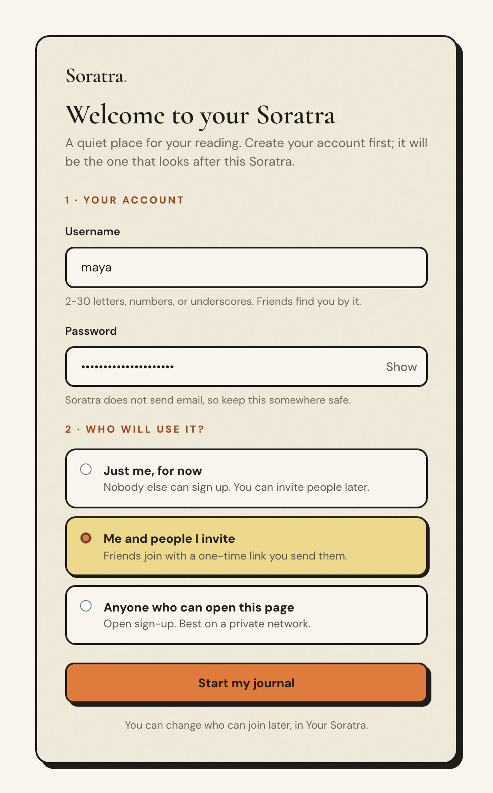
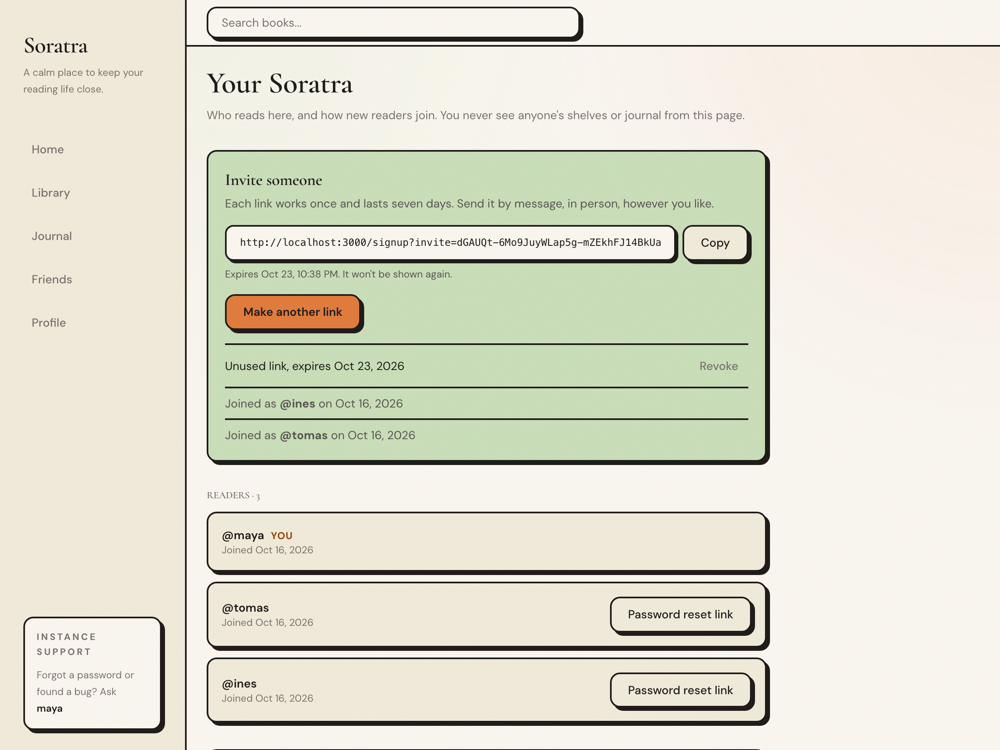
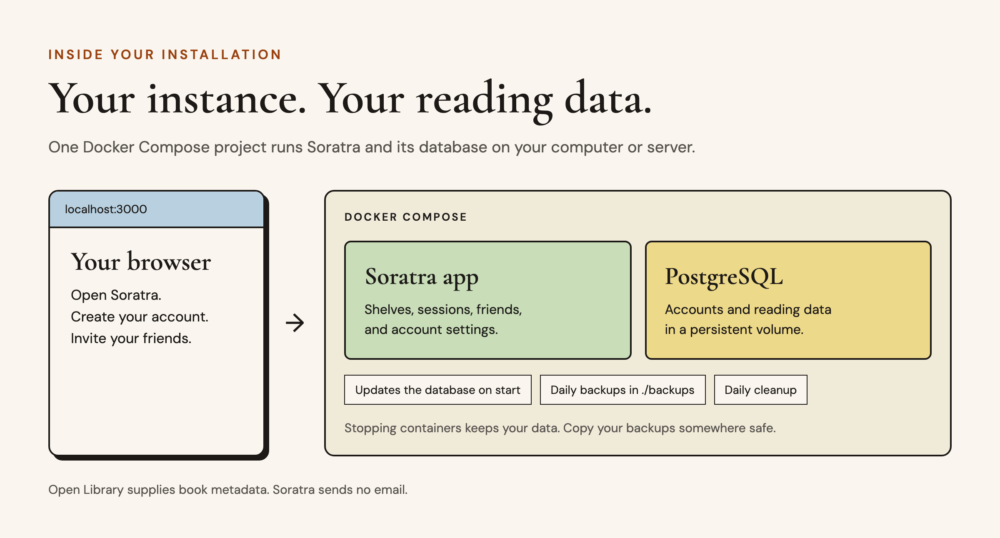

# Soratra

>*Soratra* means **"writing"** in Malagasy.

[Get started](#run-it) · [Invite friends](#invite-friends) · [Self-hosting guide](docs/SELF_HOSTING.md) · [Contributing](CONTRIBUTING.md) · [License](#license-and-attribution)

Soratra is a reading journal for yourself and a small circle of friends. Run your own copy to keep shelves, record daily reading, and share your shelves and journal with the friends you choose.

The original hosted service has shut down. This repository is the self-hosted version: you run the app and own its database. Maintenance is occasional, and there is no support or availability guarantee.

## What it does


- Shelves for books you want to read, are reading, and have read, with ratings, reviews, and finish dates.
- Daily reading sessions with minutes, ratings, notes, and spoiler controls.
- A journal, reading heatmap, time-zone-aware streaks, and a weekly streak freeze.
- Friends by exact username, with mutual consent. Removing a friend ends shared access at once.
- Account export, password changes, and account deletion.

Book search and covers come from Open Library, so those need internet access. Everything you write stays in your own database. Soratra sends no email and has no ads or third-party analytics. When you open Your Soratra, the server asks GitHub at most once a day whether a newer release is out; you can turn that off on the same page.

## Run it

You need [Docker](https://docs.docker.com/get-docker/) with Compose. In an empty folder:

```sh
curl -fsSLO https://github.com/KadirKess/Soratra/releases/latest/download/compose.yaml
docker compose up -d
```

Then open <http://localhost:3000>. That's the whole install: no settings file, no secrets to generate. The first start downloads the images and takes a minute.

On Windows, type `curl.exe` instead of `curl` in PowerShell, or download [`compose.yaml`](https://github.com/KadirKess/Soratra/releases/latest/download/compose.yaml) with your browser.

The first visit asks you to create your account and choose who can join. That account looks after the instance.



### Use it from your phone

Out of the box Soratra only answers on the computer it runs on. To open it from other devices on your network, create a file called `.env` next to `compose.yaml` containing:

```sh
SORATRA_BIND=0.0.0.0
```

Run `docker compose up -d` again, then open `http://<that computer's address>:3000` on your phone. [Tailscale](https://tailscale.com) works the same way and lets you reach it from anywhere, without opening anything to the internet.

### Put it on a domain

For a public address with HTTPS, point your domain at the server, then download the Caddy overlay and add your domain to `.env`:

```sh
curl -fsSLO https://github.com/KadirKess/Soratra/releases/latest/download/compose.caddy.yaml
echo "DOMAIN=books.example.org" >> .env
docker compose -f compose.yaml -f compose.caddy.yaml up -d
```

Caddy fetches and renews the certificate on its own. Ports 80 and 443 must be free. The [self-hosting guide](docs/SELF_HOSTING.md#https-on-your-own-domain) covers using a reverse proxy you already have.

## Invite friends

Open **Your Soratra** in the sidebar (on a phone, from **Profile**). Make an invite link and send it however you like; each one works once. Forgot passwords are handled the same way: you make a one-time reset link for that friend. You never see anyone's password or journal from this page.



## Day to day

```sh
docker compose pull && docker compose up -d   # update to the latest release
docker compose logs -f app                    # see what the app is doing
docker compose down                           # stop; your data stays
```

A backup of the database lands in `./backups` every day, and the newest seven are kept. Copy them somewhere else now and then. [Restoring one](docs/SELF_HOSTING.md#backups-and-restore) takes three commands.

Locked out of the account that runs the instance? This prints a reset link for it:

```sh
docker compose exec app soratra reset-link <your-username>
```



## Settings

None are required. To change one, put it in `.env` next to `compose.yaml` and run `docker compose up -d`. [`.env.example`](.env.example) lists them all.

| Setting | What it does |
| --- | --- |
| `SORATRA_BIND` | `0.0.0.0` to reach Soratra from other devices. Default `127.0.0.1`, this computer only. |
| `SORATRA_PORT` | The port it listens on. Default `3000`. |
| `DOMAIN` | Your domain, for `compose.caddy.yaml`. |
| `KEEP_BACKUPS` | How many daily backups to keep. Default `7`. |
| `SORATRA_VERSION` | The release to run. Default `1`, the latest 1.x. |
| `SEARCH_INDEXING` | `true` lets search engines index your landing page. Off by default. |

Your name, a way to reach you, and who can join are set in the app, on the admin page.

## Development

See [CONTRIBUTING.md](CONTRIBUTING.md) for setting up a development copy, running the tests, and how to propose changes.

The app uses Next.js App Router, React, tRPC, Drizzle, PostgreSQL, Auth.js, and Tailwind CSS. Fonts are bundled locally. Operational logging and limited first-party web-vital collection are part of the application.

The README figures use the application's own fonts and palette. Their editable layout is in [docs/readme-figures.html](docs/readme-figures.html); `node scripts/render-readme.mjs` regenerates them, and `node scripts/render-screenshots.mjs` retakes the app screenshots.

The [GitHub Actions workflow](.github/workflows/ci.yml) runs type checks, unit tests, and a production build, then starts the full Docker stack and runs browser tests against it. Pushing a version tag runs the same checks and publishes the image to `ghcr.io/kadirkess/soratra`.

## Support Soratra

Soratra is free, open source, and built in my spare time as a student. If you find it useful, you can [support its development on Ko-fi](https://ko-fi.com/soratra). Donations are optional and help me maintain and improve the project.

## License and attribution

Application code is licensed under [GNU AGPLv3](LICENSE). Commercial use is allowed under that license. Keep the required copyright and license notices and Soratra attribution. If you modify the app and let people use it over a network, AGPLv3 requires offering those users the corresponding source for your modified version. Each instance offers its own source archive on the About page. Distribution also carries source obligations; consult the license for the full terms.

The Soratra name and logo have a separate [branding policy](TRADEMARKS.md). See [NOTICE](NOTICE) for attribution and [font notices](LICENSES/README.md) for the bundled fonts, which retain their own licenses.
